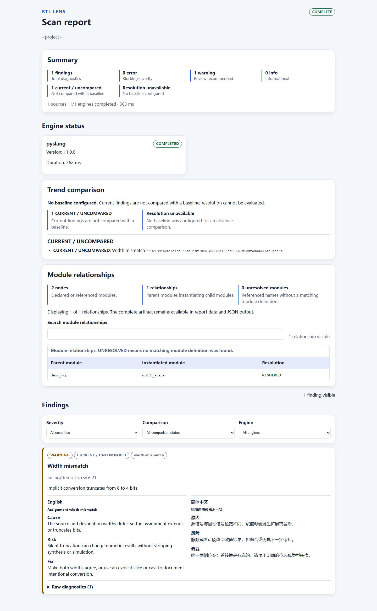

# RTL Lens

[](https://github.com/y38283004-crypto/rtl-lens/actions/workflows/ci.yml)
[](https://github.com/y38283004-crypto/rtl-lens/actions/workflows/action-smoke.yml)

Explainable, offline diagnostics for Verilog and SystemVerilog projects. RTL Lens is in
pre-release development; its public interface may change before a stable release.
This English README is the canonical user-documentation source of truth. For a Simplified Chinese
mirror of the same core contract, see [简体中文说明](README.zh-CN.md).

Use RTL Lens to inspect analyzer messages with source locations, original engine
codes, and bilingual explanations for supported rules. Keep unmapped messages
visible, search module relationships, and filter a self-contained HTML report.
PySlang provides a portable first scan; Verilator can add a second diagnostic view.

Start with the [runnable example](examples/width-demo/README.md), or
[download the offline report bundle](https://github.com/y38283004-crypto/rtl-lens/raw/refs/heads/main/docs/demo/rtl-lens-demo.zip)
and open its HTML files in a browser. The bundle contains synthetic, redacted data.

## Installation

RTL Lens is installed from a source checkout, not from PyPI. Install [uv 0.13.7](https://docs.astral.sh/uv/),
then start from the directory where you want the new checkout:

```powershell
git clone https://github.com/y38283004-crypto/rtl-lens.git
cd rtl-lens
uv sync --locked --all-groups
```

If you already have a checkout, run only `uv sync --locked --all-groups` from its root.

Use `uv run rtl-lens ...` for every command below. Supported local runtimes are
`Python >=3.11,<3.14` and `PySlang >=11,<12`. Dual-engine use additionally needs
`Verilator >=5.040` available on `PATH`. The project is licensed under `Apache-2.0`.

## Try the example

Run these commands separately from the repository root:

```powershell
uv run rtl-lens scan examples/width-demo
uv run rtl-lens scan examples/width-demo --config examples/width-demo/fixed.toml
```

| Case | Current findings | Exit code |
| --- | --- | --- |
| Implicit 8-bit to 4-bit assignment | 1 width warning | `1`, intentional policy block |
| Explicit `sample_i[3:0]` selection | 0 | `0` |

Both scans complete with PySlang only and show two modules connected by one
instantiation. The intended output in this example is the low four bits; a design
that needs all eight bits should widen the destination instead.

Open `examples/width-demo/.rtl-lens/failing/report.html` or
`examples/width-demo/.rtl-lens/fixed/report.html`. Each has a JSON companion.
See the [example walkthrough](examples/width-demo/README.md) and
[committed report snapshots](docs/demo/README.md) for exact scope and reproduction.



## Quick start

Create and review a configuration, check the local environment, and scan the project:

```powershell
uv run rtl-lens init .
uv run rtl-lens doctor .
uv run rtl-lens scan .
uv run rtl-lens explain width-mismatch
uv run rtl-lens version
```

The command names are `rtl-lens init .`, `rtl-lens doctor .`, `rtl-lens scan .`,
`rtl-lens explain width-mismatch`, and `rtl-lens version`; `uv run` selects the source
checkout environment. `scan` always renders terminal output plus JSON and self-contained HTML
reports in the configured output directory.

<!-- rtl-lens-config-example:start -->
[scan]
source_roots = ["src"]
include_dirs = []
defines = []
top_modules = ["top"]
timeout = 30
language = "en"
engine_mode = "disabled"
output_dir = ".rtl-lens"
# Optional after the first successful scan:
# baseline_path = "baseline.json"
redact_sources = false
redact_path_prefixes = []
redact_environment_variables = []
fail_on = "error"
graph_display_limit = 200
<!-- rtl-lens-config-example:end -->

This portable PySlang-only configuration sets `engine_mode = "disabled"`. For a local
dual-engine scan, set it to `"auto"` or `"required"` and install Verilator. `auto` can emit a
partial report when optional Verilator is unavailable; `required` fails instead. Configuration
precedence is defaults < `.rtl-lens.toml`/`--config` < explicit CLI `--fail-on`.
Keep `baseline_path` commented out until you have a saved prior report to compare against.

Read the [getting-started guide](docs/getting-started.md), [configuration reference](docs/configuration.md),
[architecture overview](docs/architecture.md), [privacy guide](docs/privacy.md), and
[rule catalog](docs/rules/index.md), [contribution guide](CONTRIBUTING.md),
[security policy](SECURITY.md), [Code of Conduct](CODE_OF_CONDUCT.md), and
[maintenance policy](docs/maintenance.md).

## Privacy

RTL Lens runs scans and renders reports locally. It does not send telemetry, make network
requests, or upload source code or reports. Any future remote publication or upload workflow
must remain an explicit opt-in operation and is outside the local scan contract.
Running a scan requires no account, sign-in, or paid API. Installing RTL Lens and its dependencies
may still require network access; the offline guarantee applies to scanning and report generation.

Reports remain local and unredacted unless you enable redaction. Set `scan.redact_sources = true`
to remove source snippets, redact project and home paths, and apply named path and environment
value redaction. Keep non-shareable reports local because they intentionally retain source snippets
and machine-local paths. See [privacy](docs/privacy.md) for the full boundary and sharing guidance.

## Limitations

RTL Lens is an offline development tool, not a proof of design correctness. PySlang is required;
Verilator is optional only in `auto` mode. An `auto` scan can be partial without Verilator, and
diagnostic coverage varies by language feature and analyzer support. Exit codes are: 0 success,
1 policy block, 2 runtime or required-engine failure, and 3 invalid project or configuration.
Malformed Typer syntax uses 2 before application logic.

## Contributing

This pre-release repository welcomes focused issues and changes. Follow the
[contribution guide](CONTRIBUTING.md), [security policy](SECURITY.md),
[Code of Conduct](CODE_OF_CONDUCT.md), and [maintenance policy](docs/maintenance.md); do not
publish packages, describe version 0.2 as released, or trigger remote workflows from this checkout.
