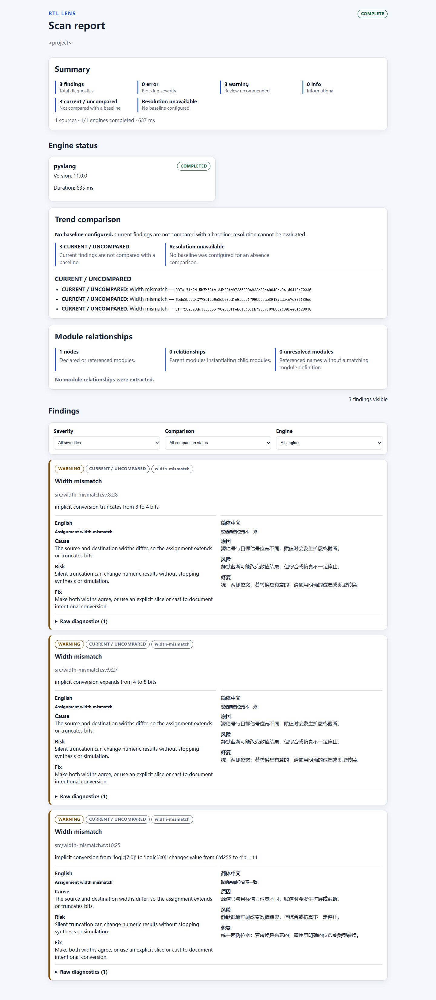

# RTL Lens

面向 Verilog 与 SystemVerilog 项目的可解释、离线诊断工具。RTL Lens 仍处于开发中的预发布阶段，
稳定版发布前其公共接口可能变化。
英文 README 才是规范源与 source of truth；本文是相同核心契约的简体中文镜像。请同时参阅
[English README](README.md)。

## 安装

RTL Lens 从源代码检出安装，未在 PyPI 提供。先安装 [uv 0.12.7](https://docs.astral.sh/uv/)，
然后在仓库根目录运行：

```powershell
uv sync --locked --all-groups
```

以下命令均通过 `uv run rtl-lens ...` 执行。支持的本地运行时为 `Python >=3.11,<3.14` 和
`PySlang >=11,<12`。双引擎使用还需要 `PATH` 中可用的 `Verilator >=5.040`。项目采用
`Apache-2.0` 许可证。

## 快速开始

创建并审阅配置，检查本地环境，然后扫描项目：

```powershell
uv run rtl-lens init .
uv run rtl-lens doctor .
uv run rtl-lens scan .
uv run rtl-lens explain width-mismatch
uv run rtl-lens version
```

命令名为 `rtl-lens init .`、`rtl-lens doctor .`、`rtl-lens scan .`、
`rtl-lens explain width-mismatch` 和 `rtl-lens version`；`uv run` 选择源代码检出的环境。
`scan` 始终生成终端输出、JSON 和自包含 HTML 报告，并写入配置的输出目录。

<!-- rtl-lens-config-example:start -->
[scan]
source_roots = ["src"]
include_dirs = []
defines = []
top_modules = ["top"]
timeout = 30
language = "en"
engine_mode = "disabled"
output_dir = ".rtl-lens"
# Optional after the first successful scan:
# baseline_path = "baseline.json"
redact_sources = false
redact_path_prefixes = []
redact_environment_variables = []
fail_on = "error"
graph_display_limit = 200
<!-- rtl-lens-config-example:end -->

此可移植的仅 PySlang 配置使用 `engine_mode = "disabled"`。若要本地双引擎扫描，请改为
`"auto"` 或 `"required"`，并安装 Verilator。可选 Verilator 不可用时，`auto` 可以生成部分
报告；`required` 会失败。配置优先级为 defaults < `.rtl-lens.toml`/`--config` < 显式 CLI
`--fail-on`。
在拥有可比较的既有报告前，请保持 `baseline_path` 为注释示例。



请阅读[入门指南](docs/getting-started.md)、[配置参考](docs/configuration.md)、[架构概览](docs/architecture.md)、
[隐私指南](docs/privacy.md)、[规则目录](docs/rules/index.md)、[贡献指南](CONTRIBUTING.md)、
[安全政策](SECURITY.md)、[行为准则](CODE_OF_CONDUCT.md)和[维护政策](docs/maintenance.md)。

## 隐私

RTL Lens 在本地执行扫描和渲染报告，不发送遥测数据、不发起网络请求，也不上传源代码或报告。
任何未来的远程发布或上传流程都必须明确由用户选择，且不属于本地扫描契约。
执行扫描无需账户、登录或付费 API。安装 RTL Lens 及其依赖仍可能需要联网；离线保证仅适用于
扫描与报告生成。

除非启用脱敏，否则报告保留在本地且不做脱敏。启用 `scan.redact_sources = true` 后，会移除
源代码片段、脱敏项目与主目录路径，并应用已命名的路径和环境变量值脱敏。不可共享的报告会保留
源代码片段和机器本地路径，请仅在本地保存。完整边界与共享说明见[隐私指南](docs/privacy.md)。

## 局限

RTL Lens 是离线开发工具，不是设计正确性的证明。PySlang 为必需依赖；Verilator 仅在 `auto`
模式下为可选。没有 Verilator 时，`auto` 扫描可能是部分报告，诊断覆盖随语言特性和分析器支持而变。
退出码：0 成功、1 策略拦截、2 运行时或必需引擎失败、3 无效项目或配置；格式错误的 Typer 语法会在
进入应用逻辑前返回 2。

## 参与贡献

这个预发布仓库欢迎聚焦的问题和改动。请遵循[贡献指南](CONTRIBUTING.md)、[安全政策](SECURITY.md)、
[行为准则](CODE_OF_CONDUCT.md)和[维护政策](docs/maintenance.md)；请勿从此检出发布软件包、
将 0.2 描述为已发布版本或触发远程工作流。
