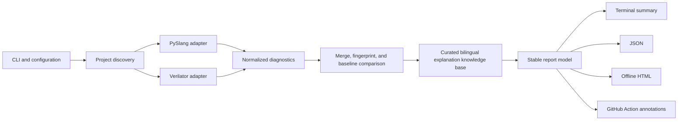

# RTL Lens Design Specification

- **Date:** 2026-08-17
- **Status:** Approved conversational design; awaiting review of this written specification
- **Repository:** `rtl-lens`
- **Distribution:** `rtl-lens` with fallback name `rtl-lens-cli` only if the package namespace becomes unavailable before publication
- **Import package:** `rtl_lens`
- **Command:** `rtl-lens`
- **License:** Apache-2.0

## 1. Product Definition

RTL Lens is a student-friendly RTL code diagnostic tool. It scans Verilog and SystemVerilog projects with PySlang and Verilator, converts low-level diagnostics into a stable common model, enriches common findings with human-reviewed Chinese and English explanations, and emits offline reports for local and continuous-integration use.

The product does not replace a compiler, simulator, synthesizer, formal-verification system, or industrial sign-off flow. Its differentiation is accessible setup, understandable guidance, privacy-preserving local operation, and a polished path from a raw diagnostic to a concrete repair.

### 1.1 Target users

- Students learning Verilog or SystemVerilog.
- Small open-source RTL projects that need an approachable quality check.
- Course staff who want deterministic feedback without commercial EDA dependencies.
- Developers who want a readable local or CI report that aggregates multiple engines.

### 1.2 Primary user promise

From a project directory, the user runs:

```text
rtl-lens scan .
```

RTL Lens produces a terminal summary, a normalized JSON result, and a self-contained offline HTML report. A user without Verilator still receives a valid PySlang scan. A user with Verilator receives merged dual-engine results.

## 2. Goals and Non-Goals

### 2.1 Goals for the first public release

- Scan synthesizable Verilog and SystemVerilog projects on ordinary computers.
- Run PySlang in-process as the always-available default engine.
- Run Verilator through a separate adapter when available locally or in the official CI/container environment.
- Normalize and de-duplicate diagnostics without concealing engine disagreement.
- Provide manually reviewed Chinese and English explanations for 30–50 high-frequency diagnostic families.
- Generate a polished, self-contained HTML report plus JSON and terminal output.
- Support baseline comparison so existing projects can block only newly introduced findings.
- Provide an environment diagnostic command, a GitHub Action, a pinned container, and reproducible development setup.
- Publish documentation and contribution paths suitable for first-time open-source contributors.

### 2.2 Non-goals for the first public release

- Writing a new SystemVerilog parser or compiler.
- Running synthesis, place-and-route, timing sign-off, or formal verification.
- Providing a browser code editor, waveform viewer, or VS Code extension.
- Supporting VHDL, Verilog-AMS, UVM-wide semantic analysis, or proprietary encrypted source.
- Using a hosted service, telemetry, a required account, a paid API, or an LLM to generate first-release explanations.
- Assigning an arbitrary overall health score.

## 3. User Experience

### 3.1 Core commands

```text
rtl-lens scan [PATH]
rtl-lens doctor
rtl-lens init
rtl-lens explain RULE_ID
rtl-lens version
```

- `scan` discovers project sources, runs enabled engines, and generates outputs.
- `doctor` reports Python, PySlang, Verilator, path, version, and configuration health without modifying the system.
- `init` creates a documented `.rtl-lens.toml` starter configuration.
- `explain` displays the curated explanation for a canonical rule.
- `version` prints RTL Lens and engine compatibility information.

### 3.2 Report layout

The report contains:

1. Project and scan metadata.
2. Counts of blocking findings, warnings, explained findings, and engines that completed.
3. A filterable issue list ordered by policy severity and source position.
4. A selected issue pane showing code context, source engines, what happened, hardware risk, and a repair suggestion.
5. A module relationship view derived from the PySlang semantic model.
6. Baseline comparison for new, existing, and resolved findings.
7. Environment and engine status.

The report does not present a composite score. It shows concrete evidence and scan completeness instead.

## 4. Architecture



### 4.1 Component boundaries

#### CLI and configuration

Owns command parsing, configuration precedence, output paths, policy thresholds, and exit status. It depends on application services but not on engine-specific APIs.

#### Project discovery

Finds `.v` and `.sv` sources, file lists, include paths, macro definitions, and requested top modules. It produces a resolved immutable project description. It does not run analysis.

#### Engine adapters

Every engine implements the same contract:

- Accept a resolved project description and a timeout.
- Return raw diagnostics, engine metadata, and a completion state.
- Never write outside an isolated temporary/output directory.
- Never call another adapter.

The PySlang adapter runs in-process and also provides semantic information for the module graph. The Verilator adapter invokes a validated executable with an argument array, requests SARIF when supported, and parses output without invoking a command shell.

#### Diagnostic normalizer

Converts engine output into the common diagnostic model. It preserves original codes and messages while assigning a canonical diagnostic family where a reviewed mapping exists.

#### Merge and baseline service

Computes stable fingerprints from canonical family, normalized source path, location, and relevant symbol or message features. It merges equivalent findings from multiple engines, retains provenance, and assigns `new`, `existing`, or `resolved` baseline status.

#### Explanation knowledge base

Stores a versioned record for each supported canonical diagnostic family:

- English and Chinese title.
- Plain-language cause.
- Hardware or verification risk.
- Repair guidance.
- Minimal failing and corrected examples.
- Source references and review status.

Knowledge entries are data, not executable code. Every entry must pass schema validation and example tests.

#### Report model and renderers

The stable report model is the only input to terminal, JSON, HTML, and CI renderers. Renderers never depend directly on PySlang or Verilator. The HTML renderer escapes all source-derived content and embeds only local static assets.

## 5. Diagnostic Data Model

Each normalized finding includes:

- Schema version and scan identifier.
- Canonical rule identifier, when known.
- Original engine name, version, rule code, severity, and message.
- Normalized policy severity.
- Repository-relative file path, line, column, and optional end position.
- Optional symbol, module, and bounded source snippet.
- Stable fingerprint.
- Engine provenance list after merging.
- Explanation identifier and explanation availability state.
- Baseline state: `new`, `existing`, or `resolved`.

The scan record also includes requested and completed engines, configuration digest, durations, failures, source count, tool versions, and redaction state.

### 5.1 Merge rules

- Findings merge only when the canonical family and normalized location match and their message/symbol features are compatible.
- Merged findings list every engine that reported them.
- Conflicting severities are preserved in provenance; policy severity is chosen by a documented deterministic mapping.
- Unknown diagnostics remain separate unless their original engine code and normalized location match.
- RTL Lens never suppresses a disagreement merely to make the report appear cleaner.

## 6. Configuration and Policy

`.rtl-lens.toml` supports:

- Source roots and explicit file lists.
- Include directories and macro definitions.
- One or more top modules.
- Enabled engines and engine executable paths.
- Scan and per-engine timeouts.
- Rule enable/disable controls and repository-relative waivers.
- Severity overrides.
- Baseline path and whether CI blocks only new findings.
- Output directory, language, and source-redaction mode.

Configuration precedence is command line, project configuration, then documented defaults. The report records the effective configuration digest.

## 7. Failure Handling and Exit Status

### 7.1 Partial completion

- If PySlang succeeds and Verilator is absent, the scan is marked partial and still produces useful output.
- If one engine fails, completed engine results remain available and the failure appears separately from code findings.
- Syntax errors do not prevent report generation when either engine provides structured diagnostics.
- Unknown diagnostics retain their original message and are labeled as lacking a curated explanation.

### 7.2 Exit codes

| Code | Meaning |
|------|---------|
| `0` | Scan completed and no configured blocking policy was triggered |
| `1` | Scan completed and a configured blocking finding was present |
| `2` | Required engine or runtime failure prevented the requested scan completeness |
| `3` | Invalid project or RTL Lens configuration |

Whether a missing optional Verilator installation returns `0` or `2` depends on configuration: automatic mode permits partial completion; explicitly requiring Verilator makes its absence a runtime failure.

## 8. Privacy and Security

- Default operation is local and offline.
- No telemetry, accounts, remote upload, or required network call is present in scan execution.
- Local reports may include bounded code snippets; redacted reports omit snippets and replace absolute paths with repository-relative paths.
- GitHub Action report upload is opt-in and documented.
- Subprocesses use argument arrays rather than a shell command string.
- Tool paths and source paths are validated before execution.
- Engine execution has timeouts and bounded output capture.
- HTML escaping is mandatory for filenames, messages, snippets, configuration, and engine output.
- Temporary directories are private to the process where the platform permits and are cleaned after use.
- The GitHub Action requests read-only repository content permissions by default and never receives secrets unless the user explicitly changes the workflow.
- Dependency versions are locked for development and pinned in the published container; releases include provenance and checksums where the hosting platform supports them.

## 9. Technology Choices

- Python 3.11–3.13 for the first public release.
- PySlang for in-process SystemVerilog parsing, type checking, elaboration, and module relationships.
- Verilator as an external mature lint engine, preferably using SARIF output.
- Typer for the command-line surface.
- Pydantic models and generated JSON Schema for configuration and report validation.
- Jinja2 plus static HTML, CSS, and minimal JavaScript for self-contained reports.
- Pytest for unit, contract, golden, and end-to-end tests.
- Ruff and a static type checker for project quality gates.
- A locked development environment and an optional pinned container for reproducibility.

The architecture does not allow frontend choices to leak into engine or diagnostic modules. A future renderer can replace the initial static presentation without changing scan behavior.

## 10. Testing Strategy

### 10.1 Unit and contract tests

- Project discovery, path normalization, configuration precedence, and validation.
- Diagnostic normalization, canonical mappings, severity policy, fingerprints, merge behavior, and baselines.
- Exit-code behavior for complete, partial, blocked, failed, and invalid scans.
- A shared adapter contract suite executed against PySlang and Verilator adapters.

### 10.2 Explanation tests

Each curated diagnostic family has:

- A minimal failing fixture.
- A corrected fixture.
- Expected engine and canonical diagnostics.
- Validated Chinese and English fields.
- A source or rationale reference.

### 10.3 End-to-end tests

- Complete PySlang-only scan.
- Complete dual-engine scan.
- Missing optional and required Verilator cases.
- Syntax-error project.
- Baseline creation and new/resolved comparison.
- Redacted and non-redacted reports.
- Paths containing spaces, Unicode, and HTML-significant characters.
- Empty project, clean project, and large diagnostic set.

### 10.4 Cross-platform and report tests

- GitHub Actions matrix for Windows, Linux, and macOS on supported Python versions for PySlang operation.
- Pinned Linux environment for the dual-engine Action and container.
- Browser-level report checks at desktop and narrow widths.
- Snapshot or structural assertions for stable report sections without overfitting cosmetic details.

### 10.5 Public-release quality gate

- Both engine paths pass end-to-end tests.
- At least 30 curated diagnostic families are reviewed and tested.
- At least 10 real public RTL repositories complete a recorded compatibility scan.
- At least 10 external beta users attempt installation and a scan; blocking onboarding failures are resolved or explicitly documented.
- No known source-disclosure, command-injection, or unescaped-report vulnerability remains open.

## 11. Packaging and Distribution

- Python package published to PyPI.
- Source and signed or checksummed release artifacts published through GitHub Releases where practical.
- Pinned container containing RTL Lens and Verilator for reproducible CI execution.
- `action.yml` at the repository root and a Marketplace listing when release requirements are satisfied.
- A one-minute local quick start and a copyable GitHub Actions example.
- English README as the default global landing page with a prominent Chinese documentation link.

The first public release includes both engine adapters. Internal milestones may temporarily contain only one adapter, but they are development checkpoints rather than promoted releases.

## 12. Maintenance and Organic Growth

### 12.1 Before launch

- Recruit at least 10 real beta users without asking them to star first.
- Scan their actual projects and record consented issue-to-fix case studies.
- Validate installation and documentation with users who did not participate in development.
- Prepare a short demo, a public sample report, and three concrete case studies.

### 12.2 Launch surfaces

- Accurate GitHub repository topics and description.
- A clear social preview image.
- PyPI, GitHub Releases, container registry, and GitHub Actions Marketplace entries.
- A technically substantive Chinese and English launch article or video.
- A standards-compliant inclusion request to relevant curated HDL lists only after the release is stable.

### 12.3 Ongoing operations

- Weekly issue triage and a public roadmap.
- Monthly small releases when useful changes are ready; urgent security or severe regression fixes are released separately.
- `good first issue` work centered on explanation entries, fixtures, translations, and compatibility tests.
- README, license, contribution guide, code of conduct, security policy, issue forms, pull-request template, and contributor acknowledgements.

### 12.4 Metrics

Primary metrics are successful external scans, repeat users, repositories using the Action, installation success, false-positive reports, explanation coverage, external issues, pull requests, and contributors. Stars, forks, and downloads are secondary indicators. One hundred authentic stars within three months is a stretch objective, not a guarantee or release criterion.

Buying stars, reciprocal star schemes, bots, irrelevant mass promotion, and fabricated adoption claims are prohibited project practices.

## 13. Eight-Week Scope

| Period | Design outcome |
|--------|----------------|
| Weeks 1–2 | Project discovery, normalized report model, CLI skeleton, and PySlang adapter |
| Weeks 3–4 | Verilator adapter, SARIF ingestion, `doctor`, merge logic, baselines, and exit policies |
| Weeks 5–6 | Curated explanations, HTML/JSON/terminal renderers, module view, and real-repository compatibility work |
| Weeks 7–8 | Cross-platform packaging, pinned container, GitHub Action, security/report verification, beta fixes, documentation, and public release |

If schedule pressure occurs, the scope reduction order is: defer the module graph polish, reduce the number of curated families to no fewer than 30, and simplify trend visualization while preserving the baseline data. Dual-engine operation, deterministic explanations, report safety, tests, and installation documentation are not cut.

## 14. Risks and Mitigations

| Risk | Mitigation |
|------|------------|
| Direct competition with mature HDL tools | Integrate mature engines and compete on explanation, onboarding, reporting, and student use cases |
| Dual-engine scope exceeds eight weeks | Enforce adapter contracts, internal milestones, and the explicit scope-reduction order |
| Windows users cannot install Verilator | Preserve native PySlang operation, provide `doctor`, and offer the pinned Action/container for full scans |
| Engine diagnostics change between versions | Preserve provenance, pin CI versions, use adapter contract tests, and version canonical mappings |
| Explanations become misleading | Require reviewed sources, failing/fixed fixtures, and deterministic text; label unknown findings honestly |
| Reports leak source or permit injection | Default offline behavior, opt-in uploads, redaction, bounded snippets, escaping, and security tests |
| Launch gains attention but no retention | Prioritize real repository adoption, baselines, CI usefulness, and contributor-friendly maintenance |
| Package name becomes unavailable | Retain product and CLI name; publish distribution as `rtl-lens-cli` while keeping import `rtl_lens` |

## 15. Acceptance Criteria for the Design

The design is accepted when the written specification clearly fixes the first-release scope, component boundaries, engine behavior, data model, error semantics, privacy, tests, distribution, operations, and scope-reduction rules without unresolved placeholders. Implementation planning begins only after the user approves this written specification.
